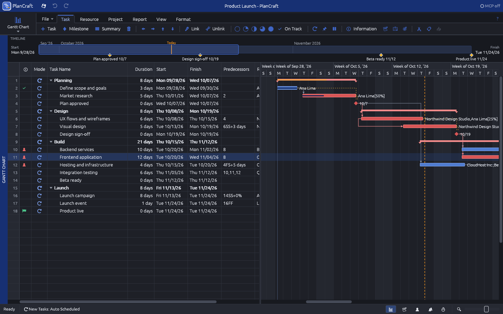
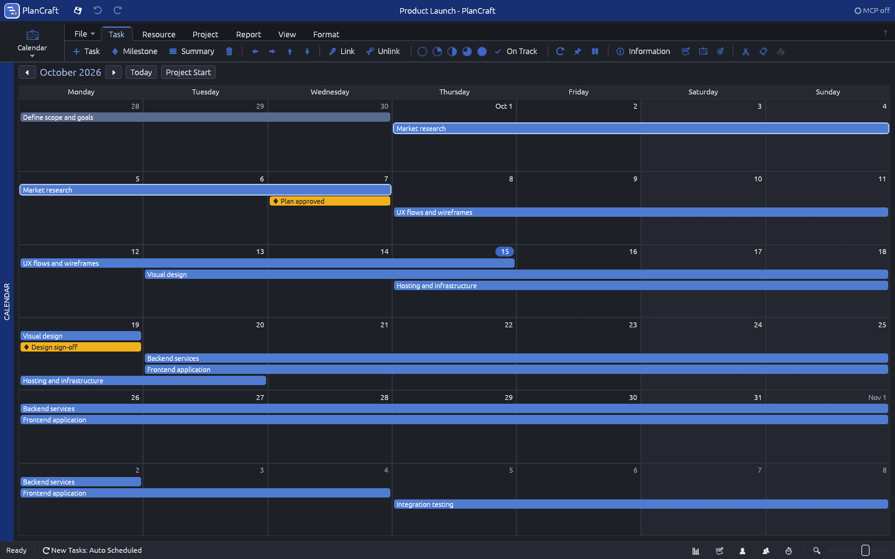
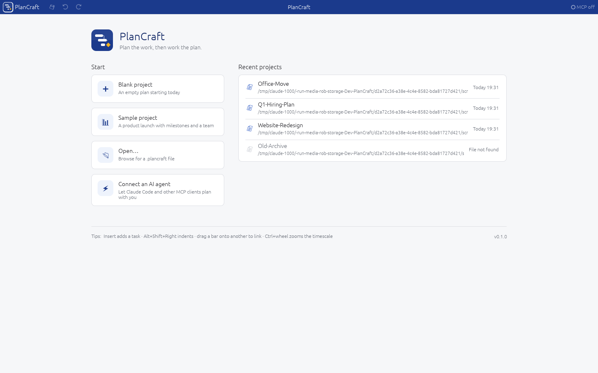

<p align="center">
  
</p>

<h1 align="center">PlanCraft</h1>

<p align="center">
  <b>Plan the work, then work the plan.</b><br>
  A desktop project planner for tasks, milestones, people and schedules,<br>
  with an AI assistant that can plan right alongside you.
</p>

<p align="center">
  
  
  
  
  <a href="https://github.com/rallegretti/PlanCraft/actions/workflows/ci.yml"></a>
</p>

<p align="center">
  <a href="#what-you-can-do-with-plancraft">Features</a> ·
  <a href="#screenshots">Screenshots</a> ·
  <a href="#installing">Install</a> ·
  <a href="#getting-started">Get started</a> ·
  <a href="#planning-with-an-ai-assistant">AI assistants</a> ·
  <a href="#your-plans-are-safe">Your plans are safe</a>
</p>

<br>


<table>
  <tr>
    <td width="25%" valign="top">
      <h3>📋 Familiar by design</h3>
      Task list, Gantt chart, resource sheet and calendars where you expect them. If you've planned a project before, you already know your way around.
    </td>
    <td width="25%" valign="top">
      <h3>⚡ Native and fast</h3>
      A native app written in Rust. A 200-task plan reschedules in well under a millisecond, so dates update as you type. No browser, no Electron.
    </td>
    <td width="25%" valign="top">
      <h3>🔒 Offline and private</h3>
      Your plans are files on your own disk. No account, no telemetry, and nothing leaves your computer.
    </td>
    <td width="25%" valign="top">
      <h3>🤖 AI-ready</h3>
      A built-in MCP server lets an assistant such as Claude Code plan with you. You see every change live and can undo any of it.
    </td>
  </tr>
</table>

<br>

## What you can do with PlanCraft

**Plan your project**
- Break work down into tasks and subtasks, typing straight into the task list like a spreadsheet.
- See everything on a **Gantt chart**: drag bars to reschedule, stretch them to change a duration, or drag one task onto another to link them.
- Link tasks so one starts when another finishes, or overlap them with leads and lags. Dates update automatically when anything changes.
- Mark the deadlines that matter and see the **critical path**, the chain of tasks that sets your finish date.

**Hit your milestones**
- A milestone is a checkpoint with a **deliverable**, for example "Signed project charter" or "Beta ready", and the tasks that must be done to reach it.
- The Milestones view shows each one's date, deliverable, progress, and whether it's on track, slipping or late.

**Manage people and partners**
- Add team members, whole teams, partner companies, vendors, contractors and equipment, with their hourly rates.
- Record vacations, holidays and part-time schedules. Work is automatically scheduled around them.
- Spot overbooked people instantly in **Resource Usage** and **Workload**, then let **Level All** spread the work out for you.
- Move work between people by dragging it in the **Team Planner**.

**Estimate and track**
- Estimate tasks in hours, with optimistic/likely/pessimistic ranges, or with simple complexity points before anyone is assigned.
- Log hours on a weekly **Timesheet** and turn tracked time into progress with one click.
- Save a **baseline** and compare it with the current plan: what slipped, what costs more, and how the project is trending.

**Work across projects**
- Make a task in one project depend on a task in another project file. When the other project slips, yours picks up the new dates the next time you open it or refresh links.
- Open several projects at once in tabs.

**Plan with AI**
- Connect an AI assistant such as **Claude Code**. It can read and change everything in your plan: build a whole task breakdown from a description, link tasks, assign people, log time, level workloads and report on status.
- You watch the changes appear live, and you can undo anything the AI did.

**Make it yours**
- Light and **dark mode**, following your system setting or chosen under **View ▸ Theme**.
- Ten views (Gantt Chart, Tracking Gantt, Task Usage, Calendar, Milestones, Resource Sheet, Resource Usage, Workload, Team Planner and Timesheet), with filters, search and different column layouts.
- Undo and redo (up to 200 steps), plus export to CSV for spreadsheets.

## Screenshots

| | |
|---|---|
|  **Dark mode**, here with the critical path shown |  **Milestones**, each with its deliverable, progress and status |
|  **Resource Usage** shows hours per person per day; overbooked days stand out |  **Workload** compares each person's planned hours with what they have available |
|  **Team Planner**: drag work from one person to another |  **Calendar** gives a month-at-a-glance view |
|  **Task Information** collects every detail of a task in one place |  **Start Page** opens your recent projects or starts a new one |

## Installing

Download the package for your computer from the [Releases page](https://github.com/rallegretti/PlanCraft/releases).

### Windows

1. Download `PlanCraft-<version>-windows-x64.zip` and extract it anywhere you like.
2. Double-click **PlanCraft.exe**.

PlanCraft isn't signed with a Microsoft certificate yet, so Windows may show *"Windows protected your PC"* the first time. Click **More info**, then **Run anyway**.

### macOS

1. Download `PlanCraft-<version>-macos-universal.dmg` and open it.
2. Drag **PlanCraft** into your **Applications** folder.
3. Open PlanCraft from Applications.

PlanCraft isn't notarized by Apple yet, so the first time you open it macOS may say it can't verify the developer. Open **System Settings ▸ Privacy & Security**, scroll down and click **Open Anyway**. The app runs natively on both Apple Silicon and Intel Macs.

### Linux

1. Download `plancraft-<version>-linux-x86_64.tar.gz`, then extract it:
   ```bash
   tar xzf plancraft-*-linux-x86_64.tar.gz
   ```
2. Install it for your user. This adds PlanCraft to your applications menu and makes `.plancraft` files open with it:
   ```bash
   ./plancraft-*-linux-x86_64/install.sh
   ```

You can also run `bin/plancraft` directly without installing. To remove PlanCraft later, run `./install.sh --uninstall`.

### Building it yourself

If you have [Rust](https://rustup.rs) installed, you can build and run PlanCraft from source:

```bash
git clone https://github.com/rallegretti/PlanCraft.git
```

```bash
cd PlanCraft
```

```bash
cargo run --release -p plancraft-app
```

## Getting started

1. **Try the sample.** On the Start Page, choose **Sample project** to explore a ready-made product launch with milestones, a team and some progress.
2. **Start your own.** Choose **Blank project**, then type task names into the task list. Press **Insert** to add a task above the selected one.
3. **Organize.** Select tasks and press **Alt+Shift+→** to indent them under a summary task.
4. **Link.** Select tasks in order and press **Ctrl+F2**, or drag one bar onto another in the chart.
5. **Assign people.** Type names into the *Resource Names* column; new names are added to your team automatically. You can also use **Resource ▸ Assign Resources**.
6. **Add milestones.** Use **Task ▸ Milestone**, then open it (double-click) to set its deliverable and the tasks that make it up.
7. **Track progress.** Use the % complete buttons on the Task toolbar, or log hours in the **Timesheet** view.

### Handy shortcuts

| Shortcut | Does |
|---|---|
| `Insert` / `Delete` | Add / remove a task |
| `F2`, or just start typing | Edit the selected cell |
| `Alt+Shift+→` / `Alt+Shift+←` | Indent / outdent |
| `Alt+Shift+↑` / `Alt+Shift+↓` | Move a task up / down |
| `Ctrl+F2` / `Ctrl+Shift+F2` | Link / unlink the selected tasks |
| `Shift+F2` | Task Information |
| `Ctrl+Z` / `Ctrl+Y` | Undo / redo |
| `Ctrl+S` | Save |
| `Ctrl` + mouse wheel | Zoom the timeline in and out |
| `Shift` + mouse wheel | Scroll the chart through time |

On a Mac, use `Cmd` instead of `Ctrl`.

## Planning with an AI assistant

PlanCraft has built-in support for the **Model Context Protocol (MCP)**, the open standard AI assistants use to work with apps. Once connected, you can ask things like:

> *"Plan a website redesign with design, build and launch phases, about eight weeks, for Ana, Ben and our design agency."*

> *"Who's overbooked next week, and what would you move?"*

> *"Log 6 hours for Ben on Backend services yesterday and tell me how the Beta milestone is looking."*

**To connect Claude Code to the PlanCraft window:**
1. In PlanCraft, open **Project ▸ AI Agents** and click **Start server**. You can tick *Start automatically* so it's always ready.
2. Copy the command the panel shows you and run it once. It looks like this, with the path to PlanCraft on your computer:
   ```bash
   claude mcp add plancraft -- /path/to/plancraft mcp --attach
   ```

Changes the AI makes appear in the window as they happen. They're marked with ⚡ in **View ▸ History**, and **Ctrl+Z** undoes them like your own edits.

The connection is private to you: each time the server starts it creates a new secret key, kept in a file only your user account can read, and PlanCraft refuses requests that don't carry it. Other apps that connect over HTTP can use the address and key shown in the panel.

AI assistants can also work on project files without the window open. The AI Agents panel shows the exact command to use, and [docs/MCP.md](docs/MCP.md) lists everything an assistant can do.

> Only connect assistants you trust. They can change your plans and save files.

## Your plans are safe

- **Saving never corrupts a file.** PlanCraft writes the new version alongside the old one and swaps them in a single step, so a crash or power cut mid-save leaves you with either the old plan or the new one, never a broken file.
- **Recovery copies.** While you work, PlanCraft keeps a copy of unsaved changes. If it ever closes unexpectedly, the Start Page offers to restore them.
- **Built not to crash.** If something goes wrong inside PlanCraft, the action that failed is undone and you get a message instead of losing your work.
- **Files from others are checked.** A damaged or unusual file is opened as far as it safely can be: out-of-range values are corrected and PlanCraft tells you what it changed.
- **Private by default.** New plan files, settings and recovery copies are readable only by your user account on macOS and Linux, because plans hold people's names and rates.

## Your files

Projects are saved as `.plancraft` files. They are plain text, so they work well with backup tools and version control, and you can open the same project on any computer running PlanCraft.

## License

PlanCraft is free and open source, dedicated to the public domain under [CC0 1.0 Universal](LICENSE).

---

<sub>Developers: see [docs/BUILDING.md](docs/BUILDING.md) for building release packages and [docs/ARCHITECTURE.md](docs/ARCHITECTURE.md) for how PlanCraft is put together.</sub>
