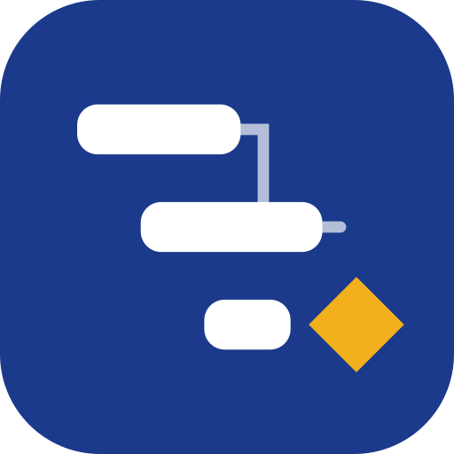
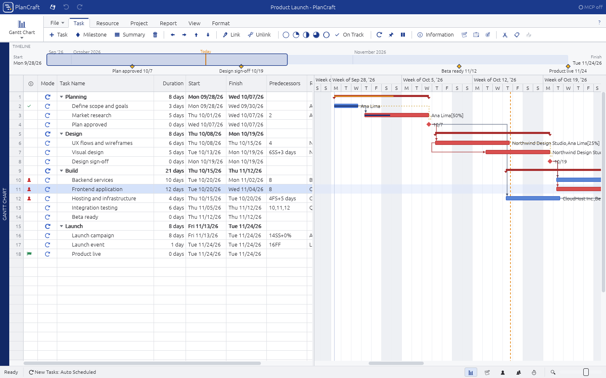
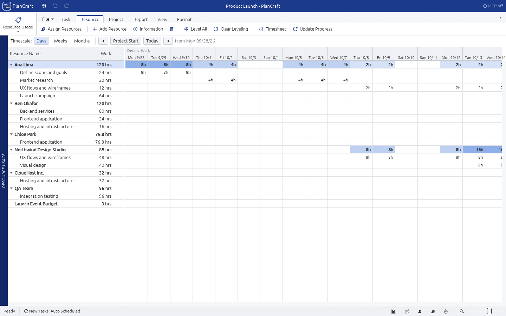
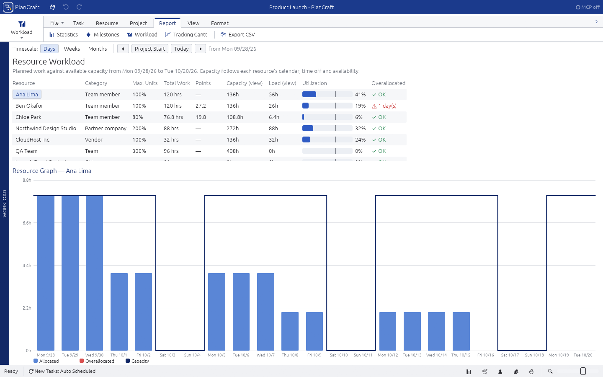
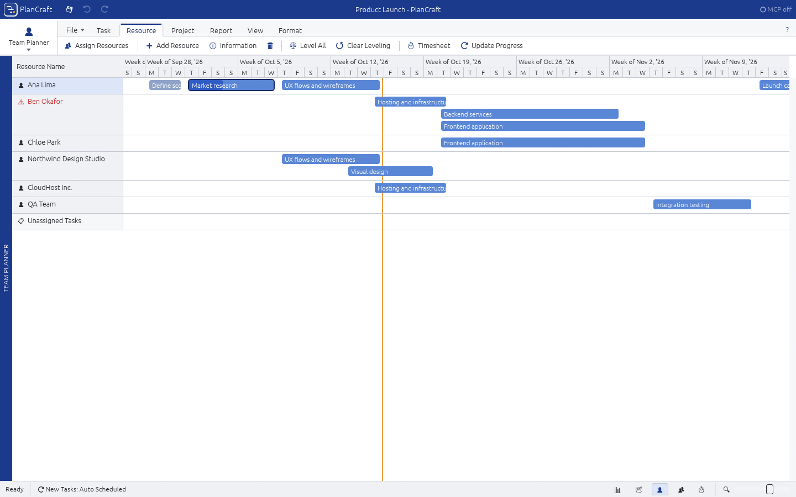
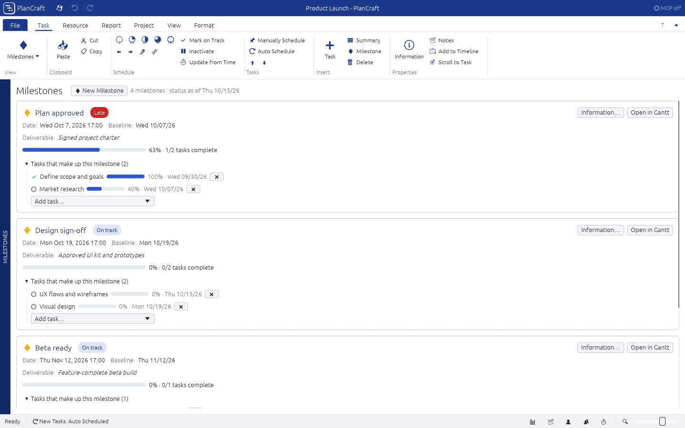
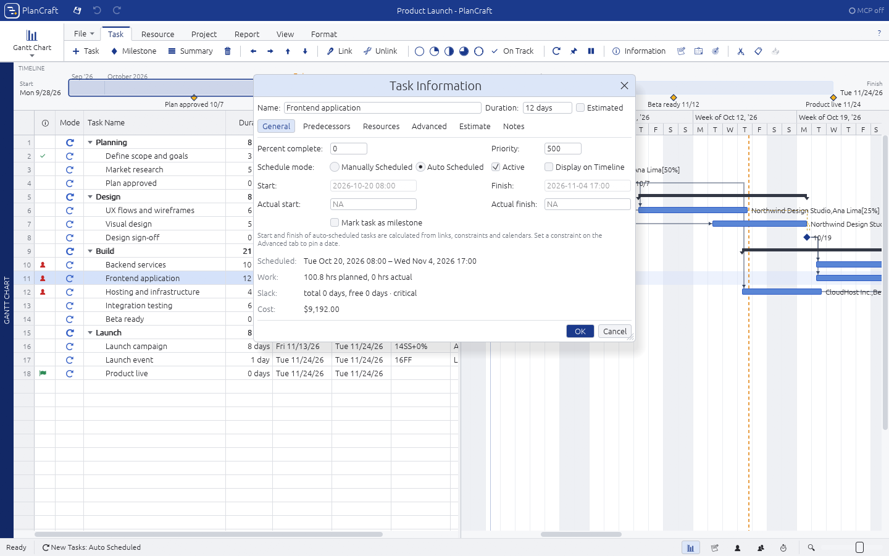
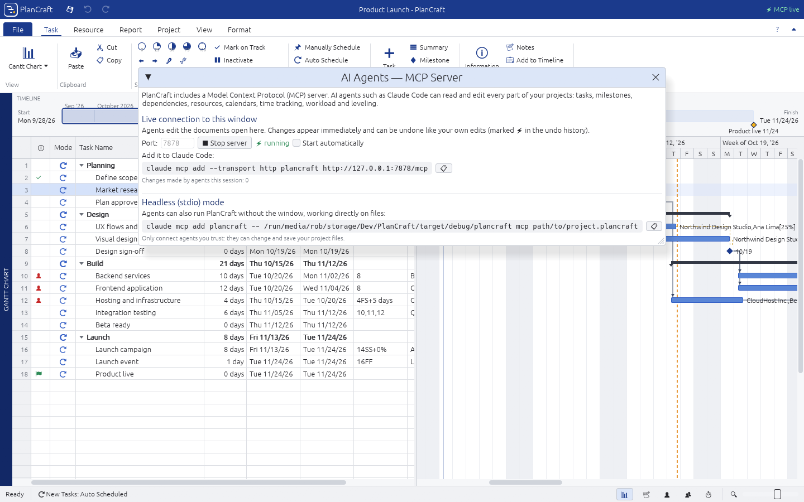

<p align="center">
  
</p>

<h1 align="center">PlanCraft</h1>

<p align="center">
  Project planning and scheduling in the spirit of Microsoft Project, written entirely in Rust,
  with a built-in MCP server so AI agents can plan alongside you.
</p>



## Highlights

- **Tasks, milestones and summaries.** Outline your work breakdown structure. Indent, outdent and move whole blocks, edit in place like a spreadsheet, and paste or cut.
- **Milestones that mean something.** A milestone is a checkpoint with a *deliverable* and a set of *member tasks*. It is reached when all of its members (and predecessors) finish, and it reports its progress, lateness and baseline slip.
- **Dependencies across files.** Use Finish-to-Start, Start-to-Start, Finish-to-Finish and Start-to-Finish links, with lags or leads in working time, elapsed time or a percentage of the predecessor. Any task or milestone can depend on a task in **another `.plancraft` document**. Linked dates are cached in the file and refreshed when it opens.
- **A real scheduling engine.**
  - Calendar-aware critical path method (CPM) with forward and backward passes.
  - Total and free slack, and critical path detection.
  - All eight Microsoft Project constraint types, deadlines, manual tasks and inactive tasks.
  - Actual start, finish and progress.
- **Resources of every kind:**
  - team members, teams, partner companies, vendors, contractors, equipment and facilities
  - *work*, *material* and *cost* resources, each with its own rates and cost per use
- **Time and availability.** Use project, task and resource calendars, holidays (including yearly ones), personal time off and part-time days. Availability periods change a resource's maximum units over time. An assigned task is scheduled in working time that all of its resources share, so a vacation delays the work.
- **Workload.**
  - Time-phased loads per resource, by day, week or month, compared against each resource's real capacity.
  - Overallocation detection, a heat-mapped Resource Usage view and a Resource Graph.
  - **Resource leveling** with one click.
- **Estimates.** Size work by **complexity points**, a **three-point (PERT)** estimate or plain work, before any resources are assigned. Estimates feed the workload and set the work and duration of the first assignment.
- **Time tracking.**
  - A weekly **Timesheet** to log hours per resource and task.
  - Actual work and actual starts roll up automatically.
  - "Update progress from time" sets each task's % complete from tracked hours.
- **Baselines and variance:** baseline start, finish, work and cost, variance columns, a Tracking Gantt, and earned value (SPI and CPI).
- **Built-in MCP server** (Model Context Protocol). Agents such as Claude Code can read and change *everything* through 67 tools:
  - **Live mode:** the agent works in the open window. You see its edits immediately and can undo them; they are marked ⚡ in the undo history.
  - **Headless mode:** the agent works directly on files.

| | |
|---|---|
|  |  |
|  |  |
|  |  |

## The interface

PlanCraft follows the layout of a familiar desktop scheduler without copying it:

- a deep-blue title band with quick-access save, undo and redo
- a two-row command bar:
  - a **view selector** on the left that spans both rows
  - plain tabs: a **File** menu, then **Task**, **Resource**, **Project**, **Report**, **View** and **Format**
  - one compact toolbar row of icon-and-label buttons for the active tab
- a **Start Page** for New, Open and Recent
- a **Timeline** strip, a vertical view label, and a split **task sheet + Gantt chart**
- a status bar with view shortcuts and a zoom slider

**Views:**

- *Task views:* Gantt Chart, Tracking Gantt, Task Usage, Calendar, Milestones
- *Resource views:* Resource Sheet, Resource Usage, Workload, Team Planner (drag tasks between people to reassign them)
- *Time tracking:* Timesheet

**Dialogs:** Task Information, Resource Information (with time off and availability), Project Information and Options, Change Working Time, Assign Resources, Links Between Projects, Project Statistics, and the MCP server panel.

**Useful shortcuts:**

| Shortcut | Action |
|---|---|
| `Insert` | New task |
| `Delete` | Delete the selection |
| `Alt+Shift+→` / `Alt+Shift+←` | Indent / outdent |
| `Alt+Shift+↑` / `Alt+Shift+↓` | Move up / down |
| `Ctrl+F2` / `Ctrl+Shift+F2` | Link / unlink tasks |
| `Shift+F2` | Task Information |
| `F2` (or just type) | Edit a cell |
| `Ctrl+Z` / `Ctrl+Y` | Undo / redo |
| `Ctrl+S` | Save |
| `Ctrl+wheel` | Zoom the timescale |
| `Shift+wheel` | Scroll in time |

In the chart:

- Drag a bar to move it. This sets a *Start No Earlier Than* constraint, just like Microsoft Project.
- Drag its right edge to change the duration, or its left edge to set progress.
- Drag a bar onto another row to link the two tasks.

## Getting started

You need a recent stable Rust toolchain (edition 2024, Rust 1.90 or later).

```bash
cargo run --release -p plancraft-app -- --demo
```

`--demo` opens a sample "Product Launch" project. Other ways to start:

```bash
cargo run --release -p plancraft-app -- path/to/project.plancraft
```

```bash
cargo run --release -p plancraft-app
```

Without arguments, the app opens the File backstage.

On Linux the app talks to Wayland or X11 directly, and file dialogs go through the XDG desktop portal. No GTK or C toolkit is required.

## Connecting an AI agent (MCP)

**Live, in the open window.** Open **Project ▸ MCP Server** (or click *MCP off* in the title bar) and press **Start server**. Then:

```bash
claude mcp add --transport http plancraft http://127.0.0.1:7878/mcp
```

**Headless, on files.** The app binary doubles as a stdio MCP server:

```bash
claude mcp add plancraft -- /path/to/plancraft mcp /path/to/project.plancraft
```

A standalone `plancraft-mcp` binary is also built from `crates/plancraft-mcp`. See [docs/MCP.md](docs/MCP.md) for every tool, resource and prompt.

Agents get tools for:

- **projects:** documents, project settings and calendars
- **tasks:** bulk creation of a whole WBS in one call, links, milestones and cross-file links
- **people:** resources, assignments, time off and availability
- **tracking:** time entries, progress and baselines
- **analysis:** schedule, critical path, workload, overallocations, leveling, statistics, earned value and variance
- **history:** undo and redo

## Project layout

```
crates/
  plancraft-core/   model, calendars, CPM scheduler, workload, leveling, reports, file I/O, undo workspace
  plancraft-mcp/    MCP server: JSON-RPC 2.0 over stdio and Streamable HTTP (tiny_http), 67 tools
  plancraft-app/    desktop app (egui/eframe): command bar, views, dialogs, live MCP host
docs/               architecture, MCP reference, roadmap, screenshots
assets/             logo (SVG) and icon (PNG)
```

More detail:

- **Design:** [docs/ARCHITECTURE.md](docs/ARCHITECTURE.md)
- **What's next:** [docs/ROADMAP.md](docs/ROADMAP.md)

## Development

```bash
cargo test --workspace
```

```bash
cargo clippy --workspace
```

**Screenshot automation** (used for the images above):

```bash
PLANCRAFT_VIEW="Resource Usage" PLANCRAFT_SCREENSHOT=out.png cargo run -p plancraft-app -- --demo
```

`PLANCRAFT_CMD=TaskInfo,Critical,Level,Mcp,…` runs commands before capturing, and `PLANCRAFT_SELECT=<row>` picks the selected task.

### Pure Rust

Everything is Rust: the scheduler, the UI (egui and wgpu), file dialogs (rfd over the XDG portal), the MCP server, and PNG encoding. The only non-Rust code is what the operating system and GPU drivers provide.

## License

[CC0 1.0 Universal](LICENSE): dedicated to the public domain.
